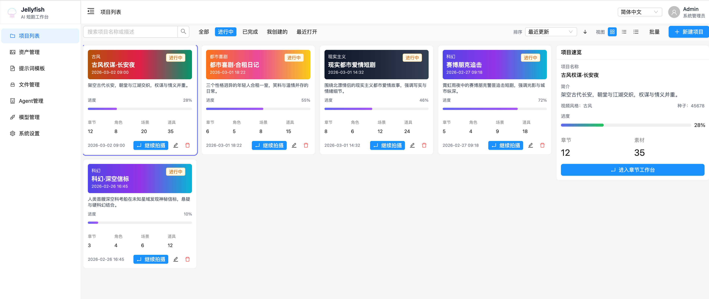

# DyeingTime AI 短剧工厂

<p align="center">
  
</p>

<p align="center">
  <a href="./LICENSE">
    
  </a>
  <a href="https://img.shields.io/badge/%E5%89%8D%E7%AB%AF-React%20%2B%20Vite-61DAFB">
    
  </a>
  <a href="https://img.shields.io/badge/%E5%90%8E%E7%AB%AF-FastAPI-009688">
    
  </a>
  <a href="https://img.shields.io/badge/%E6%8E%A7%E5%88%B6%E9%9D%A2-Go%20%2B%20chi-00ADD8">
    
  </a>
  <a href="https://img.shields.io/badge/%E4%BB%BB%E5%8A%A1-Celery%20%2B%20Redis-37814A">
    
  </a>
  <a href="https://github.com/Timeregainedme/dyeingtime/actions/workflows/quality-gates.yml/badge.svg">
    
  </a>
</p>

面向 AI 生成短剧（竖屏短剧 / 微短剧）的一站式生产工作台。
从剧本输入 → 智能分镜 → 角色/场景/道具一致性管理 → 分镜准备 → 图片/视频/配音生成 → 任务追踪 → 导出成片。

> 上线步骤、运维命令与排障记录见 **[docs/部署说明.md](./docs/部署说明.md)**；
> 完整开发文档见 **[文档站](https://timeregainedme.github.io/dyeingtime/)**。

### 🚀 快速开始

```bash
git clone https://github.com/Timeregainedme/dyeingtime.git
cd dyeingtime

# 方式一：Docker 一键起全套（MySQL + Redis + 对象存储 + 后端 + Celery + 前端）
cp deploy/compose/.env.example deploy/compose/.env
docker compose --env-file deploy/compose/.env -f deploy/compose/docker-compose.yml up -d --build

# 方式二：本地开发
cd backend && cp .env.example .env && uv sync && uv run uvicorn app.main:app --reload --port 8000
cd front   && pnpm install && pnpm dev
```

启动后：

| 入口 | 地址 |
| --- | --- |
| 前端 | `http://localhost:7788` |
| 后端 API 文档 | `http://127.0.0.1:8000/docs` |
| OpenAPI 契约 | `http://127.0.0.1:8000/openapi.json` |

---

## 📌 已接入的生成能力

| 能力 | 可用供应商 |
| --- | --- |
| 文本（含思考模式） | `deepseek`、`aliyun_bailian`、`openai` |
| 图片生成 | `pix`、`openai`、`volcengine` |
| 视频生成 | `pix`、`compshare_model_api`、`openai`、`volcengine` |
| 音频合成（TTS） | `compshare_model_api` |

新增供应商**不需要改代码**：文本供应商只需在「模型管理」里建好 Provider 与 Model 记录，
生成类供应商则通过统一的适配器注册表按 `provider` key 分派。

---

## 📷 项目截图

| 项目概览 | 资产管理 |
| --- | --- |
|  |  |

---

## ✨ 核心价值

- **把短剧生产流程串起来**：从剧本输入、分镜拆解、镜头准备，到图片/视频生成与任务追踪，尽量减少工具切换和流程割裂。
- **把 AI 结果变成可确认、可复用的生产资料**：先沉淀为分镜、候选资产、对白、提示词和生成任务，再进入后续制作。
- **把「一致性」作为核心问题来处理**：通过角色、场景、道具、服装等实体管理和镜头级关联，降低人物漂移与场景跑偏。
- **把长耗时生成变成可追踪的任务系统**：文本、图片、视频、音频等异步任务统一管理，状态可见、可取消、可恢复。
- **把 AI 能力接入做成基础设施**：模型管理、提示词模板、OpenAPI 协作和任务执行体系，为后续扩展更多工作流留出空间。

---

## ✨ 核心能力

DyeingTime 不是单点的「AI 出图 / AI 出视频」工具，而是一套面向短剧生产的工作台。
它围绕「剧本理解、分镜准备、资产一致性、生成执行、任务追踪」构建了一条可落地的主流程。

### 1. AI 剧本理解与分镜拆解

将章节剧本交给 AI 做结构化处理，形成后续制作可用的分镜基础数据：

- 剧本拆分为镜头
- 角色 / 场景 / 道具 / 服装等要素提取
- 对白提取与整理
- 剧本优化、简化与一致性检查
- 角色画像、场景信息、道具信息等专项分析

### 2. 分镜准备与确认工作流

主流程是：

```text
剧本拆分 → 分镜准备 → 候选确认 → 镜头 ready → 进入生成工作台
```

准备阶段支持：

- 提取并刷新镜头候选信息
- 确认或忽略资产候选
- 接受或忽略对白候选
- 关联已有角色 / 场景 / 道具 / 服装
- 对单镜头基础信息进行修正
- 用统一状态判断镜头是否完成准备

### 3. 资产一致性与复用体系

覆盖角色、演员、场景、道具、服装的统一实体管理，支持实体库管理、镜头级关联、图片管理与复用，
尽量减少跨镜头生成时的内容漂移。

### 4. 镜头级图片与视频生成编排

镜头进入 `ready` 后，可在生成工作台完成生成准备与执行：

- 关键帧与参考图管理
- 镜头级视频提示词预览
- 图片 / 视频生成任务发起
- 单镜头与批量生成前检查
- 生成结果回流到镜头与素材体系

### 5. 统一任务中心与异步执行能力

- 文本处理 / 图片 / 视频 / 音频任务异步执行
- 任务状态、进度、结果、耗时统一追踪
- 任务取消
- 全局任务中心查看运行中与最近完成任务
- 从任务回到对应项目 / 章节 / 镜头上下文

### 6. 模型、提示词与生成基础设施

- 多 Provider / 多模型管理
- 模型分类（文本 / 图片 / 视频 / 音频）与默认模型设置
- 提示词模板管理
- 文件与生成素材管理
- OpenAPI 驱动的前后端接口协作

### 7. 工作区多租户与角色权限

`/api/v1` 下所有业务数据都归属于某个**工作区（租户）**：

- 四级角色矩阵 `viewer / editor / admin / owner`，`viewer` 只读、不可发起生成
- 跨工作区访问一律返回 **404**（而非 403），避免把资源 ID 变成可枚举面
- 写操作强制走 `editor` 及以上，防止只读账号消耗供应商额度
- 供应商密钥**落库即密文**（Fernet + `enc:v1:` 前缀），密钥不落明文
- 所有 `/api/v1` 写操作留审计日志（成功与失败都记，不记请求体）

> 详见 [多租户与工作区隔离](https://timeregainedme.github.io/dyeingtime/docs/architecture/workspace-multitenancy/) 与
> [密钥加密与操作审计](https://timeregainedme.github.io/dyeingtime/docs/architecture/secrets-and-audit/)。

### 8. Go 控制面 + Python 执行面的混合架构

后端拆成两层：

```text
Nginx ──按路径切流──┬──> Go 控制面   (:8001)  鉴权 / 用户 / 工作区 / 项目·章节·镜头元数据
                    │                 文件列表与下载 / 任务状态与结果查询
                    └──> Python 执行面 (:8000)  剧本处理 / 资产合并 / 生成编排 / 视频准备度
```

- Go 侧只接管「薄资源」（只读、低逻辑密度、高频），写方法**自动回落 Python**，前端无感
- 两端共享同一份 MySQL 与 `JWT_SECRET`，Go 只校验 JWT 不签发
- 响应信封、时间序列化、分页 422 语义逐字节对齐，可用**影子对比**验证切流

> 详见 [Go 控制面](https://timeregainedme.github.io/dyeingtime/docs/architecture/go-control-plane/)。

---

## 🚀 主要功能一览

### 项目与章节管理

- 创建和管理项目、章节
- 以章节为单位承载剧本、分镜与生成流程
- 提供基础统计与工作台入口

### AI 剧本处理

- 将章节剧本拆分为多个镜头
- 提取角色、场景、道具、服装与对白信息
- 支持剧本优化、简化与一致性检查
- 支持角色画像、场景信息、道具信息等专项分析

### 分镜准备工作流

- 编辑镜头标题、摘要和基础信息
- 提取并刷新资产 / 对白候选
- 确认、忽略或关联候选项
- 通过统一准备态判断镜头是否完成确认
- 明确区分「准备完成」和「生成中」

### 资产与实体管理

- 管理角色、演员、场景、道具、服装等实体
- 支持镜头级关联与复用
- 支持实体图片管理
- 支持名称存在性检查，辅助复用已有资产

### 镜头生成工作台

- 管理关键帧、参考图与视频提示词
- 检查镜头视频生成准备度
- 发起图片 / 视频 / 配音生成任务
- 支持单镜头和批量推进生成流程

### 任务中心

- 统一查看运行中与最近完成的任务
- 跟踪任务状态、进度、耗时与结果
- 支持取消任务
- 支持从任务快速回到对应项目、章节或镜头

### 模型与提示词基础设施

- 管理 Provider、Model 与默认模型设置
- 管理图片、视频、分镜等提示词模板
- 通过 OpenAPI 生成前端请求与类型
- 为后续扩展更多 AI 工作流提供统一底座

### 文件与素材管理

- 管理上传文件与生成产物（图片 / 视频 / 音频）
- 统一预览、关联和复用素材
- 为镜头和实体提供可回溯的素材支撑

---

## 🎯 适用场景

- 短剧 / 微短剧内容创作者
- AI 影视工作室批量生产
- 个人创作者低成本试水竖屏短剧
- 教育 / 培训机构制作教学短视频
- 品牌 / 电商制作带剧情的产品宣传短片

---

## 🛠 技术栈

**前端**

- React 18 + TypeScript 5 + Vite 5
- Tailwind CSS 3 + shadcn/ui（Radix UI）—— 新页面使用；Ant Design 5 —— 存量页面仍在迁移中
- Zustand（状态管理）+ React Router 6
- i18next（多语言）+ axios
- Vitest（单元测试）+ Playwright（端到端测试）
- OpenAPI 生成式客户端（`openapi-typescript-codegen`）

**后端（执行面）**

- FastAPI + Uvicorn（Pydantic v2 / pydantic-settings）
- SQLAlchemy 2.0（async，`aiomysql`）
- Celery + Redis（异步任务队列，图片 / 视频 / 默认三条独立队列）
- LangChain / LangGraph（剧本处理与 LLM 编排）
- boto3 + httpx（对象存储与第三方 API 调用）

**控制面**

- Go 1.27 + chi（HTTP 路由）
- oapi-codegen（由 `front/openapi.json` 生成类型，前后端与 Go 三方共享同一份契约）
- `golang-jwt`（只校验，不签发）

**基础设施**

- MySQL 8（业务数据）
- Redis 7（Celery Broker）
- S3 兼容对象存储（承载上传与生成素材；生产用 Cloudflare R2，本地 compose 用 RustFS）

---

## 🐳 Docker 一键部署（推荐）

编排文件位于 `deploy/compose/`，包含
**MySQL + Redis + RustFS + Backend + Celery Worker + Front** 六个服务，另有两个一次性初始化容器。

### 预构建镜像

CI 每次推送到 `main` 会构建并推送镜像到 GitHub Container Registry：

```bash
docker pull ghcr.io/timeregainedme/dyeingtime/backend:latest
docker pull ghcr.io/timeregainedme/dyeingtime/front:latest
```

镜像基于仓库根目录的 `deploy/docker/*.Dockerfile` 构建；compose 里的 `backend` /
`front` 服务默认走本地构建，加 `--build` 即可改为从源码重建。

### 端口

| 服务 | 地址 |
| --- | --- |
| 前端 | `http://localhost:7788` |
| 后端 API | `http://localhost:8000`（`/docs` 为 Swagger，`/openapi.json` 为契约） |
| MySQL | `localhost:${MYSQL_PORT:-3306}` |
| Redis | `localhost:${REDIS_PORT:-6379}` |
| RustFS S3 API | `http://localhost:${RUSTFS_PORT:-9000}` |
| RustFS Console | `http://localhost:${RUSTFS_CONSOLE_PORT:-9001}` |

### 启动

```bash
cp deploy/compose/.env.example deploy/compose/.env
docker compose --env-file deploy/compose/.env -f deploy/compose/docker-compose.yml up -d --build
```

### 三个必须知道的部署要点

1. **S3 必须用 path 寻址**：`S3_ADDRESSING_STYLE=path`。容器内置 DNS 无法解析
   `<bucket>.<service>` 形式的虚拟主机名，用 `virtual` 会直接连接失败。
2. **素材直链必须浏览器可达**：`S3_PUBLIC_BASE_URL=http://localhost:9000/dyeingtime-assets`。
   不设置时后端返回容器内地址，前端图片无法显示。
3. **bucket 需要公共读策略**：初始化容器已内置 `init_storage_public.py`，会创建 bucket 并
   幂等写入仅含 `s3:GetObject` 的公共读策略，否则素材直链返回 403。

> 若 3306 端口被占用（例如已有本机 MySQL/MariaDB），把 `.env` 里的 `MYSQL_PORT`
> 改成别的端口即可，例如 `3307`。
> 端口冲突、僵尸容器、代理等具体排障记录见 [docs/部署说明.md](./docs/部署说明.md)。

---

## 🔌 模型供应商配置

代码层已内置适配器的供应商：

| 供应商 | 类别 | 默认 Base URL |
| --- | --- | --- |
| `pix`（PIX） | 图片 / 视频 | `https://pix.token6688.com` |
| `compshare_model_api`（优云智算「模型 API」） | 视频 / 音频 | `https://cp.compshare.cn` |
| `deepseek`（DeepSeek） | 文本 | `https://api.deepseek.com/v1` |
| `openai` | 文本 / 图片 / 视频 | 需自行配置 |
| `volcengine`（火山引擎） | 图片 / 视频 | 需自行配置 |
| `aliyun_bailian`（阿里百炼） | 文本 | 需自行配置 |

### 填写 API Key

出于安全考虑，仓库内**不包含任何 API Key**。启动后进入前端
**AI 工作室 → 模型管理**，编辑对应供应商，在「API Key」一栏填入你自己的密钥并保存即可。
未填 Key 时，发起生成任务会返回 `503 Provider api_key is empty for provider_id=…`。

### 关于文本供应商的「思考模式」

`enable_thinking` 属于 DashScope 私有参数，若不加区分地下发给所有供应商，
会导致 DeepSeek 这类使用不同参数名的供应商思考开关失效。
本项目按供应商做映射：

| 供应商 | `thinking=True` | `thinking=False` |
| --- | --- | --- |
| `aliyun_bailian` | `{"enable_thinking": true}` | `{"enable_thinking": false}` |
| `deepseek` | `{"thinking": {"type": "enabled"}}` | `{"thinking": {"type": "disabled"}}` |
| 其他（OpenAI / PIX / 优云智算等） | 不下发任何思考参数 | 不下发任何思考参数 |

---

## 🧑‍💻 本地开发

### 后端

```bash
cd backend
cp .env.example .env
uv sync
uv run uvicorn app.main:app --reload --host 0.0.0.0 --port 8000
```

启动后：

- Swagger 文档：`http://127.0.0.1:8000/docs`
- OpenAPI 契约：`http://127.0.0.1:8000/openapi.json`

### 前端

```bash
cd front
pnpm install
pnpm dev
```

### 数据库迁移

迁移是 `backend/sql/` 下的纯 SQL 文件，由 compose 的一次性服务 `mysql-init-sql` 按文件名顺序执行：

```text
backend/sql/001-init-prompt-template.sql
backend/sql/002-add-shot-extracted-candidates.sql
...
backend/sql/027-add-style-prompt-pack.sql
backend/sql/028-rewrite-image-prompt-templates.sql
backend/sql/029-update-h3-agent-prompt.sql
backend/sql/030-add-fallback-text-model.sql
backend/sql/031-add-asset-prompt-snapshots.sql
backend/sql/032-update-script-division-agent-prompt.sql
backend/sql/033-update-script-agents-prompts.sql
```

**新增迁移请追加为下一个未占用序号的新文件（如 `034-*.sql`），不要修改已应用的编号文件。**
所有迁移脚本都写成幂等形式（`CREATE TABLE IF NOT EXISTS` / `information_schema` 判定），
重复执行不会报错。

> 涉及表结构变更时，除新增 SQL 文件外还要同步更新 SQLAlchemy 模型
> （`backend/app/models/`）与 `backend/app/core/db.py` 的建表注册。

### OpenAPI 契约同步

**任何后端接口变更后，必须重新生成前端请求与类型**，禁止手写 service 封装：

```bash
# 前端开发服务与后端（127.0.0.1:8000）都在运行时
cd front
pnpm run openapi:update
```

生成产物位于 `front/src/services/generated/`，契约缓存为 `front/openapi.json`。
后端侧有契约比对脚本，会校验「后端当前产出的规格」与「前端冻结的基线」是否漂移：

```bash
cd backend
uv run python scripts/check_openapi_contract.py
```

---

## ✅ 质量门禁

CI（`.github/workflows/quality-gates.yml`）在 PR 与 Merge queue 上跑三道门禁：

| 门禁 | 命令 | 说明 |
| --- | --- | --- |
| 后端测试 | `uv run pytest tests -q` | 565 个用例，覆盖 API 信封、多租户隔离、密钥加密、审计、生成链路 |
| 前端类型 | `pnpm run typecheck` | `tsc --noEmit` |
| OpenAPI 契约 | `uv run python scripts/check_openapi_contract.py` | 发现契约漂移即失败 |

本地复现：

```bash
# 后端
cd backend && uv sync --group dev && uv run pytest -q

# 前端
cd front && pnpm install && pnpm exec tsc --noEmit

# 前端测试
cd front && pnpm test        # Vitest 单元测试
cd front && pnpm test:e2e    # Playwright 端到端（需 Playwright 浏览器）
```

Go 控制面另有一套测试：

```bash
cd backend/go && go test ./...
```

> ⚠️ Go 侧目前**不在 CI 门禁内**，需要人工保证 `go build` / `go vet` / `go test` 通过。

---

## 📁 目录结构

```text
dyeingtime/
├── backend/                  # Python 执行面
│   ├── app/
│   │   ├── api/v1/routes/    # 路由层（收参、鉴权、响应组织）
│   │   ├── services/         # 业务逻辑层（状态流转、数据编排）
│   │   ├── core/
│   │   │   ├── contracts/    # 跨层 DTO 契约
│   │   │   ├── integrations/ # 各供应商 HTTP 适配器
│   │   │   └── tasks/        # 任务封装与执行编排
│   │   ├── models/           # SQLAlchemy 模型
│   │   └── schemas/          # Pydantic 入参/出参
│   ├── go/                   # Go 控制面（只读接口 + 写方法回落 Python）
│   ├── sql/                  # 数据库迁移（纯 SQL，按序号执行）
│   ├── scripts/              # 契约校验、密钥加密、供应商探测等工具
│   └── tests/
├── front/                    # React 前端
│   ├── src/app/              # 应用外壳（导航、面包屑、主题）
│   ├── src/features/         # 新页面（项目卡片、镜头看板、风格管理…）
│   ├── src/components/ui/    # shadcn/ui 基础组件
│   ├── src/pages/aiStudio/   # 存量业务页面（迁移中）
│   ├── e2e/                  # Playwright 端到端测试
│   └── src/services/generated/   # OpenAPI 生成的请求与类型
├── deploy/
│   ├── compose/              # Docker 编排与 .env 模板
│   ├── nginx/                # 生产 Nginx 站点与 Go 控制面切流配置
│   └── scripts/              # 生产巡检脚本
├── docs/                     # 部署说明、SOP、供应商配置、归档评审
│   ├── archive/              # 历史评审与方案（仅供追溯，不作为现行依据）
│   └── img/                  # README 截图资源
├── site/                     # Hugo 文档站（发布说明与开发文档）
├── scripts/                  # Docker 封装与全链路冒烟脚本
├── AGENTS.md                 # 项目开发规范（分层、注释、文档归属）
├── CONTRIBUTING.md           # 贡献指南
├── LICENSE                   # MIT 协议
└── NOTICE                    # 许可沿革与第三方组件许可
```

---

## 📚 文档

完整文档在 **[文档站](https://timeregainedme.github.io/dyeingtime/)**，按栏目严格区分职责：

| 栏目 | 回答什么问题 | 位置 |
| --- | --- | --- |
| `architecture` | 现在是什么（已生效的实现与边界） | `site/content/docs/architecture/` |
| `plans` | 接下来做什么（正在推进的改造） | `site/content/docs/plans/` |
| `guide` | 怎么做（操作说明、开发流程） | `site/content/docs/guide/` |
| `reference` | 查什么（稳定参考资料） | `site/content/docs/reference/` |
| `blog` | 每个版本改了什么 | `site/content/blog/` |

几个常用入口：

- [多租户与工作区隔离](https://timeregainedme.github.io/dyeingtime/docs/architecture/workspace-multitenancy/)
- [Go 控制面](https://timeregainedme.github.io/dyeingtime/docs/architecture/go-control-plane/)
- [密钥加密与操作审计](https://timeregainedme.github.io/dyeingtime/docs/architecture/secrets-and-audit/)
- [分镜状态流转](https://timeregainedme.github.io/dyeingtime/docs/architecture/shot-status-flow/)
- [分镜主流程与页面职责边界](https://timeregainedme.github.io/dyeingtime/docs/architecture/shot-page-boundary/)
- [生产环境状态快照](https://timeregainedme.github.io/dyeingtime/docs/architecture/production-state/)

本地预览文档站：

```bash
cd site && hugo server
```

---

## 🤝 参与贡献

欢迎提交 Issue 与 Pull Request。开始前请先阅读：

- **[AGENTS.md](./AGENTS.md)** —— 项目开发规范：后端分层职责、注释要求、状态语义、文档归属、提交前自检清单
- **[CONTRIBUTING.md](./CONTRIBUTING.md)** —— 贡献流程、提交信息规范与门禁要求

提交信息首行须为 `[类型] 摘要`，类型取自：

```text
feat  fix  docs  style  refactor  perf  test  chore  ci  build  revert
```

本地校验钩子（一次性启用）：

```bash
git config core.hooksPath .githooks
```

> 涉及后端接口、类型或状态模型变更时，请同步更新后端实现、OpenAPI 契约、
> 前端 generated types 与对应开发文档。

---

## 📄 版权与许可

本项目以 **MIT** 协议开源，著作权归 **Timeregainedme** 所有。

详见 [LICENSE](./LICENSE) 与 [NOTICE](./NOTICE)。项目自最初的 Apache-2.0
版本演化而来（ChangeAT → Jellyfish → DyeingTime），作者保留原 Apache-2.0
版本下已对外发布副本所享有的权利。

> 第三方依赖（FastAPI、React、Ant Design 等）仍遵循各自的许可协议。

---

## ⚠️ 使用须知

- **仓库内不含任何 API Key**，供应商密钥需要你在「模型管理」里自行填写。
  密钥落库时会自动加密（Fernet），但**配额与费用由你使用的供应商承担**。
- 图片 / 视频 / 音频生成会**真实调用第三方接口并产生费用**，批量生成前请确认额度。
- 部署到公网前请至少完成：更换默认管理员密码、配置 `GOOGLE_ALLOWED_EMAILS` 白名单、
  设置 `SECRETS_KEY` 与 `JWT_SECRET`、为对象存储配置私有读与签名访问。
- 本项目生成的内容涉及 AI 产出，商用前请自行确认目标平台的合规要求。

---

## 🙏 致谢

- [LINUX DO](https://linux.do) —— 真诚、友善、团结、专业的技术社区，感谢佬友们的交流与支持。

## 💬 交流与反馈

- 问题反馈、功能建议与使用讨论：请在本仓库提交 Issue
- 开发文档与版本说明：<https://timeregainedme.github.io/dyeingtime/>
